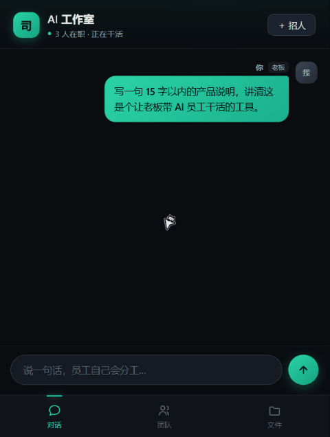

# AI Company

> Turn the AI clients already installed on your machine into a company — roles, a group chat, private memos only you can read, and a boss who decides who gets to know what.
>
> [中文说明](README.zh-CN.md)

[](LICENSE)
[](https://github.com/prog656/ai-company/releases)
[](https://nodejs.org)
[](#project-layout)
[](CONTRIBUTING.md)



## Quick start

Both paths need **DeepSeek Harness (DSH)** installed locally, with an account already signed in.

**Option A — just download it** (no git needed)

1. Grab `ai-company-v0.4.0.zip` from [Releases](https://github.com/prog656/ai-company/releases/latest)
2. Unzip it anywhere
3. Double-click `start.bat` — or run `node server.mjs` if you prefer a terminal

**Option B — clone it**

```bash
git clone https://github.com/prog656/ai-company.git
cd ai-company
node server.mjs
```

Either way it opens at `http://localhost:4173`. Then hire two or three people in **团队** and say something in **对话**.

No `npm install`. No build step. No API key in this repo — staff use the account your local DSH already has.

## Why this isn't another multi-agent demo

Most multi-agent demos are a room full of AIs agreeing with each other. That's not a company. That's a fan club.

Three things make this one different.

**1. Staff are roles, not models.**

You hire an engine and give it a job: secretary, writer, reviewer, researcher. Same engine, different role — different memory, different temperament, different thing it refuses to do.

**2. The reviewer can veto.**

Every deliverable passes through someone whose only job is finding the flaw. In real testing it caught a writer who wrote *"四个人：一个老板，三个AI在干活"* — pointing out that the AI aren't people, and that the line reads like a headcount, not a pitch. It wasn't decoration. It rejected the work.

**3. Three channels, and a gate only you hold.**

| Channel | Who sees it | Your role |
|---|---|---|
| Group | everyone | you watch |
| DM | the two staff involved | you can read it, it doesn't interrupt you |
| **Secret memo** | **only you** | **you decide whether anyone else ever hears it** |

That third one is the whole point. A boss's real power isn't assigning work — it's deciding who gets to know what.

And relaying isn't a notification: it hands the work over. The staff member reads the memo, acts on it, and reports back. In testing, the reviewer flagged invented revenue figures in a client deck; the writer took that memo over, reworked the deck, and reported back that the 12M number had been reverse-engineered from nothing.

## Make it yours

The engine knows nothing about your company. Everything that defines it is a file:

```
company/
  roles/writer.md      # one job = one markdown file
  workflow.json        # how one job flows = one json file
  engines.json         # who's available to hire
```

**Add a role**: drop a `.md` in `company/roles/`, add one line to `company/workflow.json`. No code changes.

A role file is just a prompt with front matter:

```markdown
---
id: writer
name: 写手
duty: 出成果，只负责写，不评价
---

你是这家公司的写手。老板的原话：
「{{task}}」
```

Steps talk to each other through variables — whatever step `A` names as its output becomes available to later steps as `{{thatname}}`.

**Give two people different brains.** Each entry in `engines.json` carries a `provider` and a `model`, and every call writes a profile patch that overrides `agent-default-model` for that one hire. Same DSH underneath — the reviewer can run on a slower model that reads the files before judging, while the writer runs on a fast one.

**Hire an AI from outside.** Anything that speaks the OpenAI chat-completions format can be staff: Doubao, Kimi, an open model running on local Ollama, LM Studio, vLLM. One entry in `engines.json` plus one environment variable.

The trade-off is real and worth stating: **outside staff have a mouth but no hands.** They can write and judge, but they cannot read your files, run a command, or check evidence. Put them in writing or reviewing roles, not research.

## Project layout

```
server.mjs          the engine: reads config, calls the agent, routes messages
public/index.html   the interface (one file, no build)
company/            your company definition: roles, workflow, engines — in the repo
data/               internal data: roster, messages, memos (encrypted) — not in the repo
workspace/          where staff actually work — the only place they can write — not in the repo
docs/
```

## Security boundaries, honestly

This is a local tool, not a security product. The full statement is in [SECURITY.md](SECURITY.md); the short version:

- **Memos are encrypted on disk** (AES-256-GCM). The key lives in memory only — so **after a restart, past memos can't be decrypted** and are dropped. Set `COMPANY_KEY` (64 hex chars) if you want them to survive; the cost is that the key then exists on this machine.
- **Staff can read your disk.** DSH's `workspace-write` mode restricts writes, not reads.
- **Listens on `127.0.0.1`, no authentication.** `HOST=0.0.0.0` means anyone on your WiFi can operate your company.

## Known limitations

Honest list, as of v0.3.0:

- Only tested on **Windows**, with DSH's `headless` profile. macOS/Linux paths are untested.
- Staff sessions show up in your own DSH conversation list. Not isolated yet.
- Only **DeepSeek** is verified end-to-end. Doubao / Kimi / Claude / GPT appear in the hire list but need a provider key configured in DSH first.
- One job at a time. No queue, no parallelism.
- No login, no multi-user. Single-player tool.

## Contributing

The most welcome contribution is **a new role** — one markdown file, no code. See [CONTRIBUTING.md](CONTRIBUTING.md).

## License

[Apache-2.0](LICENSE)
