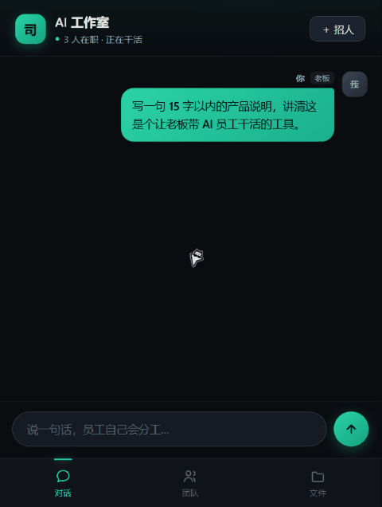

# AI 工作室

> 把你电脑上已经装着的几个 AI，编成一家公司——有岗位、有群聊、有只给你一个人看的密报，还有你这个决定「谁该知道什么」的老板。
>
> [English](README.md)

[](LICENSE)
[](https://github.com/prog656/ai-company/releases)
[](https://nodejs.org)
[](#项目结构)
[](CONTRIBUTING.md)



## 怎么跑起来

两条路都需要本机先装好 **DeepSeek Harness（DSH）**，账号已经能正常对话。

**方式 A —— 直接下载**（不用 git，也不用懂命令行）

1. 从 [Releases](https://github.com/prog656/ai-company/releases/latest) 下载 `ai-company-v0.4.0.zip`
2. 解压到任意目录
3. 双击 `start.bat` —— 或者在该目录执行 `node server.mjs`

**方式 B —— clone**

```bash
git clone https://github.com/prog656/ai-company.git
cd ai-company
node server.mjs
```

两种方式都会打开 `http://localhost:4173`。然后去**团队**招两三个人，到**对话**说一句话。

不用 `npm install`，没有构建步骤，仓库里不存任何 API key——员工用的是你本机 DSH 里已经配好的账号。

### 网页端还是桌面端，你选

| 双击 | 你看到什么 |
|---|---|
| `start.bat` | 浏览器里开一个普通标签页 |
| `start-desktop.vbs` | **一个独立窗口** —— 没有地址栏、没有标签页、没有书签栏，看起来就是装了个应用 |

桌面窗口**不是 Electron**。它借的是你系统里已经装好的 Edge 内核，所以仓库仍然是零依赖、几百 KB，而不是一百多 MB。关掉窗口，应用就退出了。

## 打开之后怎么用

第一次打开是空的，这是正常的。四步。

**第 1 步 · 招人**

点右上角「**招人**」。先选谁（DeepSeek Flash 就行），再选干什么。

建议第一次招三个：

| 岗位 | 它在公司里干什么 |
|---|---|
| 秘书 | 把你的话拆成一条别人能执行的指令 |
| 写手 | 出活。只负责写，不评价 |
| 审稿人 | 唯一职责就是挑错，有否决权 |

一个岗位只能一个人。想换人，先去「团队」让人离职。

**第 2 步 · 说一句话**

在底部输入框写你要什么。**直接说要什么，不用客套，也不用写"请帮我"。**

说得具体，它干得好：

> 写一句 15 字以内的产品说明，讲清这是个让老板带 AI 员工干活的工具。

说得含糊，它会来回问你，反而慢：

> 帮我写点东西。

**第 3 步 · 看他们干活**

发出去之后不用管。秘书会把你的话翻译成一条明确指令交给写手，写手交稿，审稿人挑错。界面上会实时显示谁在干什么、正在用什么工具。

一个回合通常几十秒。慢是正常的——审稿人会真的去翻文件找证据。

**第 4 步 · 只有你能看的那部分**

审稿人有时候会写一条**密报**——琥珀色边框的卡片，只有你能看。

看到密报，你有两个选择：

- **转给某个员工** → 这不是「通知他一声」，是**把这件事交给他**。他会读到、接手、回话，甚至再写一条密报给你。
- **不转** → 就你和写密报的人知道。

这是这个工具唯一真正独特的地方：**老板的权力不是派活，是决定谁该知道什么。**

## 三个页面分别干什么

| 页面 | 用途 |
|---|---|
| **对话** | 你说活、看员工干活、处理密报 |
| **团队** | 看有谁在、每个人跑在哪个模型上、让人离职 |
| **文件** | 所有干完的活，同时落成真的 markdown 文件，在 `workspace/deliverables/` 里能直接打开 |

## 想让员工更聪明？

默认就够用。想更强，两件事可以做：

**换个脑子。** 同一个 DSH，可以让审稿人跑在 `deepseek-reasoner` 上（慢，但会先读文件再判断），写手跑在 `deepseek-flash` 上（快）。招人的时候直接选。

**招外面的 AI。** 豆包、Kimi、本地 Ollama 都能当员工，见下面「改成你自己的公司」。

## 它和别的多 Agent 演示不一样在哪

现在多 Agent 的演示，大多是一屋子 AI 互相点头。那不是公司，那是吹捧现场。

这个不一样的地方有三处。

**一、员工是岗位，不是模型。**

你雇一个引擎，再给它一个岗位：秘书、写手、审稿人、调研员。同一个引擎，换个岗位就是另一个人——记忆不同、脾气不同、拒绝的活儿也不同。

**二、审稿人有否决权。**

每一份交付都要过一个「唯一职责就是挑错」的人。实测里它抓到过写手写的 *「四个人：一个老板，三个AI在干活」*——指出三个 AI 不能算人，而且整句读起来像在清点人头，不像在介绍公司。它不是摆设，它真的打回。

**三、三条通道，和一个只有你手里的闸门。**

| 通道 | 谁能看见 | 你的位置 |
|---|---|---|
| 群里 | 所有人 | 看着 |
| 私聊 | 当事的两个员工 | 你看得见，但它不打断你 |
| **密报** | **只有你** | **要不要让别人知道，你定** |

第三条是整个东西的题眼。老板真正的权力不是派活，是决定谁该知道什么。

而且转出去不是「通知一声」，是**把活交出去**——员工会读到、接手、再回话。实测里审稿人指出方案里的营收数字是编的，写手接过这条密报重做了一版，最后回来说：那个 1,200 万是他按比例反推的，客户数据一点没有。

## 改成你自己的公司

引擎完全不知道你的公司长什么样。定义公司的全是文件：

```
company/
  roles/writer.md      # 一个岗位 = 一个 markdown 文件
  workflow.json        # 一件活怎么走 = 一个 json 文件
  engines.json         # 能招哪些引擎
```

**加一个岗位**：在 `company/roles/` 放一个 `.md`，在 `company/workflow.json` 里加一行。不用改代码。

一个岗位文件，就是一段带元信息的提示词：

```markdown
---
id: writer
name: 写手
duty: 出成果，只负责写，不评价
---

你是这家公司的写手。老板的原话：
「{{task}}」
```

步骤之间靠变量说话——前一步声明的输出名，后一步就能用 `{{那个名字}}` 取到。

**让两个人用不同的脑子。** `engines.json` 里每条引擎都带 `provider` 和 `model`，每次叫醒员工都会写一份 profile patch，覆盖这一次调用的 `agent-default-model`。底下还是同一个 DSH——审稿人可以跑在慢但会先读文件的模型上，写手跑在快的那个上。

**从外面招 AI 进来。** 任何说得上 OpenAI chat-completions 格式的服务都能当员工：豆包、Kimi、跑在本地 Ollama 上的开源模型、LM Studio、vLLM。`engines.json` 写一行，再设一个环境变量。

代价要说清楚：**外面的员工只有嘴，没有手脚。** 它们能写、能审，但读不了你的文件、跑不了命令、查不了证据。所以放在写手和审稿这种岗位上，别放调研。

接一个进来的步骤：

1. 把 `.env.example` 复制成 `.env`
2. 在 `DOUBAO_API_KEY=` 后面粘上你的 key
3. 重启（`node server.mjs`）

key 一在，那个引擎就自动变成可招的。不用改代码，`.env` 也不会离开你的电脑。

## 项目结构

```
server.mjs          引擎：读配置、叫员工、路由消息
public/index.html   界面（单文件，无构建）
company/            公司定义：岗位、流程、引擎 —— 进仓库
data/               内部数据：名册、消息、密报（加密）—— 不进仓库
workspace/          员工的工作区，也是他们唯一能动手的地方 —— 不进仓库
docs/
```

## 安全边界（如实说）

这是本地单人工具，不是安全产品。完整说明在 [SECURITY.md](SECURITY.md)，短版：

- **密报在磁盘上是加密的**（AES-256-GCM），密钥默认只存在进程内存里，所以**重启之后历史密报就解不开了**，会被直接丢弃。想留住历史就设 `COMPANY_KEY`（64 位十六进制），代价是密钥会落在本机。
- **员工有磁盘读权限**：DSH 的 `workspace-write` 只限制「写」，不限制「读」。
- **默认只监听 `127.0.0.1`，没有登录**。设 `HOST=0.0.0.0` 等于同一个 WiFi 下谁都能操作你的公司。

## 已知限制

照实写，v0.3.0 的状态：

- 只在 **Windows** 上、用 DSH 的 `headless` 模式验证过。macOS / Linux 的路径没测。
- 员工的会话会出现在你自己的 DSH 会话列表里，目前还没有隔离。
- 只有 **DeepSeek** 端到端跑通了。豆包 / Kimi / Claude / GPT 出现在招聘列表里，但要先在 DSH 里配好对应的密钥。
- 一次只办一件事，没有队列，没有并发。
- 没有登录，没有多用户。这是单人工具。

## 参与贡献

最受欢迎的贡献是**加一个岗位**——一个 markdown 文件，不用写代码。详见 [CONTRIBUTING.md](CONTRIBUTING.md)。

## 许可证

[Apache-2.0](LICENSE)
